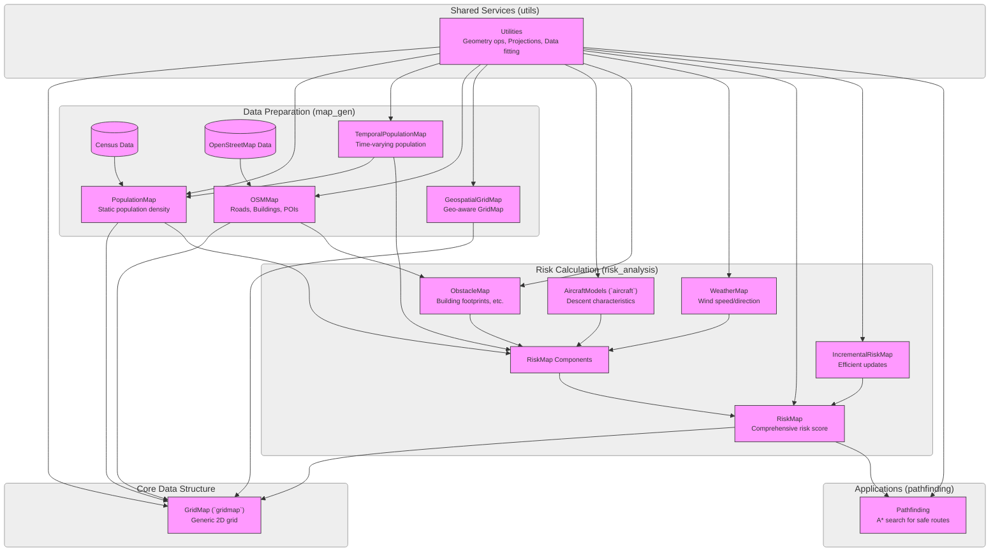

# uasgroundrisk

Ground Risk calculation for Unmanned Aerial Systems.

## Project Overview

uasgroundrisk is a C++ library for calculating ground risk for Unmanned Aerial Systems (UAS). It provides tools for generating risk maps based on population density, road networks, building footprints, and other geospatial data. The library also includes models for aircraft descent and weather conditions to provide a comprehensive risk assessment.

## Modules

The `uasgroundrisk` library is composed of several interconnected modules:

*   **GridMap (`gridmap`):** This is a foundational module providing a generic 2D grid data structure. It's used by other modules to store and query spatially referenced data. Each cell in the grid can hold multiple layers of information.

*   **Map Generation (`map_gen`):** This module is responsible for creating various types of maps used in risk assessment.
    *   **PopulationMap:** Generates static population density maps, typically derived from census data. It uses the `GridMap` to store population counts or densities per grid cell.
    *   **TemporalPopulationMap:** Extends `PopulationMap` to account for changes in population density over time (e.g., day vs. night, weekday vs. weekend). This also utilizes the `GridMap` structure.
    *   **OSMMap:** Integrates with OpenStreetMap (OSM) data to extract features like roads, buildings, and points of interest. It processes OSM data and can populate `GridMap` layers with relevant information (e.g., building footprints, road locations).
    *   **GeospatialGridMap:** A specialized `GridMap` that understands geographic coordinate systems and projections, crucial for accurately representing real-world data.

*   **Risk Analysis (`risk_analysis`):** This core module performs the actual ground risk calculations.
    *   **Aircraft Models (`aircraft`):** Contains models for aircraft behavior, particularly descent characteristics (e.g., ballistic descent, glide, parachute). These models help predict the potential impact area in case of an incident.
    *   **ObstacleMap:** Represents obstacles on the ground, primarily buildings, which can affect aircraft descent paths and shelter populations. This often sources data from `OSMMap`.
    *   **WeatherMap:** Incorporates weather data, such as wind speed and direction, which can influence an aircraft's trajectory during an emergency descent.
    *   **RiskMap:** Combines data from `PopulationMap` (or `TemporalPopulationMap`), `AircraftModel`, `ObstacleMap`, and `WeatherMap` to calculate a comprehensive ground risk score for each cell in a `GridMap`. It assesses the probability of an aircraft impacting a given area and the potential consequences based on population and obstacles.
    *   **IncrementalRiskMap:** An extension of `RiskMap` that allows for efficient updates to the risk assessment as new data (e.g., updated weather, new obstacle information) becomes available, without needing to recalculate everything from scratch.

*   **Pathfinding (`pathfinding`):** This module includes algorithms like A* search. While not directly part of risk calculation, it can utilize `RiskMap` outputs to find the safest routes for UAS operations, avoiding high-risk areas.

*   **Utilities (`utils`):** Contains helper functions and classes used across the library, such as geometry operations, data fitting algorithms, and projection utilities for handling geospatial coordinate transformations.

These modules work together: `map_gen` creates the foundational data layers (population, OSM features) stored in `GridMap` structures. The `risk_analysis` module then consumes these maps, along with aircraft and weather models, to produce detailed risk assessments, also often stored as `GridMap` layers. The `pathfinding` module can then use these risk maps for operational planning.

### Module Relationships Diagram



## Dependencies

This project uses [Conan](https://conan.io/) to manage dependencies. To install the dependencies, you will need to have Conan installed.

```bash
# Install dependencies using Conan
conan install . --output-folder=build --build=missing
```

## Building the Project

This project uses CMake for building.

```bash
# Create a build directory
mkdir build && cd build

# Configure CMake
# Replace <path_to_conan_toolchain_file> with the actual path to the conan_toolchain.cmake file generated by conan install
# e.g., build/conan_toolchain.cmake if you ran conan install from the project root and specified --output-folder=build
cmake .. -DCMAKE_TOOLCHAIN_FILE=<path_to_conan_toolchain_file>

# Build the project
cmake --build .
```

### Build Options

*   `UGR_BUILD_TESTS`: Set to `ON` to build tests (default: `OFF`).
    ```bash
    cmake .. -DCMAKE_TOOLCHAIN_FILE=<path_to_conan_toolchain_file> -DUGR_BUILD_TESTS=ON
    ```
*   `UGR_BUILD_DOCS`: Set to `ON` to build documentation (default: `OFF`).
    ```bash
    cmake .. -DCMAKE_TOOLCHAIN_FILE=<path_to_conan_toolchain_file> -DUGR_BUILD_DOCS=ON
    ```

## Running Tests

If you built the project with `UGR_BUILD_TESTS=ON`, you can run the tests using CTest:

```bash
# From the build directory
ctest
```

## License

This project is licensed under the GNU Lesser General Public License v2.1 - see the [LICENSE](LICENSE) file for details.
